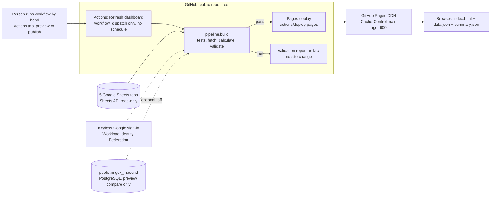
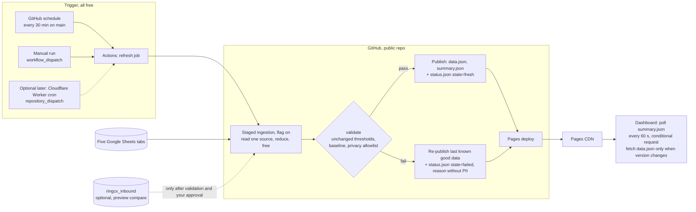

# BFF Transfers Dashboard: architecture recommendation for a $0 incremental monthly cost

Status: **review only. Nothing was pushed, deployed, published, scheduled, provisioned or billed, and no database,
production setting or Truck Master system was touched.** Prepared on branch `feature/scalable-platform-audit`.

Evidence labels used throughout: **Verified** (read or measured in this session), **User-stated** (you told me; I
could not confirm it), **Estimate** (my arithmetic from verified inputs) and **Unknown** (needs access I do not have).
This document complements `docs/phase_c_design.md`.

Internal review draft: it discusses a separate business system from user-stated information. Review it before
publishing it with a public repository.

## 1. Bottom line

1. **Keep GitHub Pages + GitHub Actions and publish validated static JSON.** It is already in production, it costs
   $0 while the repository stays public (verified), and it needs no new server, database or credential.
2. **Do not reuse Truck Master infrastructure for BFF.** I could not verify any Truck Master component from evidence
   available to me, none is needed, and coupling two businesses' systems would add risk with no saving.
3. **Add no API/backend.** A backend cannot be shown to run at $0 here: Cloud Run at the cadence the Sheets reads
   allow exceeds its free tier, and every other free platform checked either forbids commercial use, cannot run the
   Python pipeline, or needs a billing account. Section 7.
4. **Realistic refresh interval with the current Google Sheets sources: every 30 minutes.** Observed refresh runs take
   3 to 17 minutes. 15 minutes is possible only after measurement shows the slow cases are rare; 5 minutes is not realistic.
5. **Continue the local staged-ingestion work** (flag off by default) as the memory fix. It needs no infrastructure.

## 2. What I could and could not verify about Truck Master

| Claim (User-stated) | What I found | Status |
|---|---|---|
| React + TypeScript frontend, Vercel | No repository on this machine. Your public GitHub has a repo named `Truckmasters`, but it is a static HTML page with four videos (last pushed March 2025), not a React app | **Unverified** |
| Node.js REST API "TMSBackend" | Not found locally or in your public repositories | **Unverified** |
| PostgreSQL with Prisma | No `schema.prisma` found. A local PostgreSQL service exists on the review machine; I did not connect to it (no credentials, owner unknown) | Service exists; purpose **Unknown** |
| Redis job queues | No Redis service or binary found | **Unverified** |
| AWS | No AWS tooling or configuration found on the review machine; AWS use is user-stated | AWS use plausible; RDS **Unknown** |
| Cloudflare Tunnel | `cloudflared` is installed; no tunnel config exists on the review machine | Tool present; tunnel **Unverified** |
| Windows Services / NSSM | No NSSM, no Truck Master service; Node, Git and Python are installed | **Unverified** on the review machine |

A separate security observation about credential handling was reported to the owner directly. It is deliberately not
recorded in this repository.

Conclusion: I cannot assess Truck Master's capacity, account, network, billing or plan from evidence. Where the
matrix (section 5) says "Unknown", that is the honest state, not a hedge.

## 3. Current BFF architecture (verified)

Verified facts: the repository is **public**; the live files are `index.html`, `data.json` (112 KB, 300 rows) and
`summary.json` (790 bytes), served with `Cache-Control: max-age=600` and an `ETag`; the refresh workflow has **only
ever been run by hand** (8 runs on 23-24 Oct 2026, no `schedule` runs); the last publish was 24 Oct 2026 13:44 UTC.
The Google identity is keyless (no stored key); the only secret is the optional `RINGCX_DATABASE_URL`.

**Measured refresh behaviour (GitHub run history, 8 runs):**

| Result | Count | Durations (minutes) |
|---|---|---|
| Success | 6 | 3.1, 3.3, 10.4, 10.9, 11.8, 15.3 (median 10.7) |
| Failure | 2 | 2.8, 17.3 |

In the five successful runs I inspected step by step, "fetch Google Sheets, calculate, validate" took 2.6 to 11.2
minutes, install about 0.2 and the Pages deploy about 0.2. The variation is Google read latency, not our code
(calculation is under 2 seconds at today's volume). **Two of eight runs failed (25%)**, one only after 17 minutes, so
retry and last-known-good behaviour matter more than raw speed.

## 4. The three options

| | A. GitHub Pages + Actions, static JSON | B. Reuse existing PostgreSQL/RDS and existing compute | C. Separate API/backend |
|---|---|---|---|
| Incremental cost | **$0** while the repo is public (Actions minutes free for public repos; verified) | $0 only if capacity, network and access check out (**Unknown**) | **Not shown to be $0** (section 7) |
| New attack surface | None (static, allowlisted fields only) | Database reachable from GitHub runners (dynamic addresses) or from a PC | Public API, secrets, auth to maintain |
| Meets "poll for a new version, fetch on change" (60 s interval as built; 15 s was the first target) | Yes, with conditional requests on `summary.json` (section 8.2) | Not by itself | Yes |
| `fresh / refreshing / stale / failed` states | `fresh`, `stale`, `failed` fully; `refreshing` only with an extra status publish (section 8.3) | Needs an API | Fully |
| Preserves last-known-good | Yes: a failed run publishes nothing | Yes if pointer-swap is built | Yes |
| Handles millions of rows | Memory yes (staged ingestion); source ceiling is Sheets (20 M cells per file; verified) | Yes, plus staging history | Yes |
| Verdict | **Recommended** | Optional later, RingCX read only | **Only if A cannot meet a stated requirement; none so far** |

Option B's real value is narrow: reading RingCX from `ringcx_inbound` instead of a slow sheet, after the durable
ordering is validated and you approve. It is not needed to publish the report.

## 5. Component reuse matrix

| Component | Evidence | Reusable for BFF at $0? | Safe? | Verdict |
|---|---|---|---|---|
| GitHub Actions (BFF repo) | Verified in use | **Yes**, free for public repos | Yes; public logs/artifacts hold aggregate counts only | **Use** |
| GitHub Pages (BFF repo) | Verified in use | **Yes** (1 GB site, 100 GB/month soft) | Public by design; allowlisted fields only | **Use** |
| Google Sheets API + keyless sign-in | Verified in use | **Yes** (free; 300 reads/min/project) | Yes, read-only scope | **Use** |
| `ringcx_inbound` in PostgreSQL | Verified in code; owner reports 222,165 rows | Read-only, off by default | Needs a read-only role and a safe network path (**Unknown**) | **Optional later (RingCX, after approval)** |
| Existing PostgreSQL/RDS capacity | **Unknown** (never named in the repo) | Unknown | Unknown | Do not assume |
| TM Node REST API (TMSBackend) | Unverified | Unknown | Mixing two businesses' data/credentials in one service is a risk | **No** |
| TM PostgreSQL + Prisma | Unverified; an unidentified local PostgreSQL service exists on the review machine | Unknown | Production data must not share a schema/role with BFF | **No** |
| TM Redis job queues | Unverified; none on the review machine | n/a | BFF has no queue need | **No** |
| TM React/TypeScript frontend | Unverified | n/a | BFF page is one static file | **No** |
| Vercel | Hobby is **non-commercial only**, cron **once per day, +/-59 min precision** (verified). TM's plan is **Unknown** | Hobby: no. Pro: not $0 | n/a | **No** |
| AWS account / S3 | Account and plan **Unknown**. New AWS accounts get credits and a free plan that ends in 6 months (verified) | Unknown | Do not reuse Truck Master's AWS credentials | **No** |
| Cloudflare Tunnel / `cloudflared` | Tool installed on the review machine; no config found | Not needed | A tunnel to a home PC adds exposure | **No** |
| Cloudflare Workers cron (free) | Account existence inferred, **unverified**. Free: 100,000 requests/day, 5 cron triggers, 10 ms CPU | Could *trigger* Actions every minute-granularity | Needs a GitHub token stored as a Worker secret | **Optional later** (section 6.2) |
| Windows Services / NSSM / Task Scheduler on a PC | None found | $0 but the PC must be on 24/7 | Credentials on a personal PC; single point of failure | **Fallback only** |
| Local PostgreSQL service on the review machine | Running; not accessed | Could host a *local benchmark* with your approval and credentials | Not for production | **Benchmark only, if approved** |

## 6. Verified limits and costs

### 6.1 Verified (official documentation read in this session)

| Platform | Fact | Source |
|---|---|---|
| GitHub Actions | Standard runners are **free for public repositories**. Free personal accounts get **2,000 minutes/month** for *private* repositories; without a payment method, use is **blocked** after the quota, with one it is billed | docs.github.com billing for Actions |
| GitHub Actions | Max job time **6 hours**; **20 concurrent jobs** on Free; artifact storage 500 MB on Free | docs.github.com Actions limits |
| GitHub Actions `schedule` | Shortest interval **5 minutes**; "can be delayed during periods of high loads" and "some queued jobs may be dropped"; runs **only on the default branch**; in public repos **disabled after 60 days without repository activity** | docs.github.com events that trigger workflows |
| GitHub Pages | Site <= **1 GB**; **100 GB/month** soft bandwidth; **10 builds/hour soft limit does not apply** to custom Actions deployments; deploy timeout **10 minutes**; not for running a commercial SaaS | docs.github.com Pages limits |
| Live BFF site | `Cache-Control: max-age=600`, `ETag` present, `Last-Modified` 24 Oct 13:44 UTC | HTTP headers read from your site |
| Google Sheets API | **300 reads/min/project, 60/min/user**; **180 s** request timeout; **2 MB** recommended payload; quota overage "planned to incur charges later in 2026" | developers.google.com Sheets limits |
| Google Sheets file | **20 million cells** and 100 MB per spreadsheet (raised from 10 M, GA Sept 2026) | workspaceupdates.googleblog.com |
| Google Cloud | **A Cloud Billing account is required** for the free tier; overage is billed. Cloud Run request-based free tier: 2 M requests, 180,000 vCPU-s, 360,000 GiB-s per month | docs.cloud.google.com free features |
| Cloud Run | Local files count against memory; job task timeout up to 168 h | docs.cloud.google.com Cloud Run |
| Vercel Hobby | **Non-commercial, personal use only**; cron **once per day**, precision **+/-59 min**; 100 deployments/day; function max 300 s | vercel.com/docs |
| Cloudflare Workers Free | 100,000 requests/day; **10 ms CPU** per request or cron run; 5 cron triggers/account; cron granularity down to every minute; 128 MB memory | developers.cloudflare.com |
| Cloudflare R2 | 10 GB-month storage, 1 M Class A and 10 M Class B operations, free egress; whether a payment method is required was **not stated** | developers.cloudflare.com/r2 |
| AWS Free Tier | New accounts: Free plan with credits (up to $200) for up to **6 months**, then the account is suspended unless upgraded; Lambda always free: 1 M requests, 400,000 GB-s/month. Credit-expiry wording in AWS sources conflicts (6 vs 12 months) | aws.amazon.com / docs.aws.amazon.com |

### 6.2 Estimates (arithmetic from the verified inputs)

| Item | Estimate |
|---|---|
| Actions minutes at 30-minute cadence, about 10 min per run | 1,440 runs/month, about **14,400 min/month**: free while public; **would exceed the 2,000-minute private-repo quota in about 4 days** and then be blocked |
| Pages deploys | 1,440/month; no builds/hour limit applies; each file set is about 115 KB |
| Dashboard polling `summary.json` (about 0.9 KB) every 60 s per open tab | 43,200 requests/month if a tab stays open and visible all month; measured on the live site, a conditional request answered `304` is about 395 bytes and a full response about 1,525, so about 17 MB/month per tab when the report is unchanged (66 MB if every check were a full response); 100 tabs about 1.7 to 6.6 GB, well under 100 GB |
| Cloud Run job, 1 vCPU, 10 min, 15-minute cadence | about 1.7 M vCPU-s/month against a 180,000 vCPU-s request-based free allowance: **not free** (roughly $29/month at the quoted job rate) |
| Largest per-run Cloud Run time that fits the free vCPU-seconds at 30-minute cadence | 180,000 / 1,440 = **125 s per run**; today's runs take 3 to 17 minutes |

### 6.3 Unknown (not assumed)
Truck Master's actual hosting plans, the AWS account's free-plan state, whether an RDS instance exists and its
capacity and network exposure, the real cadence you would tolerate, and how often a Sheets read exceeds 15 minutes
(only 8 runs of history exist).

## 7. Why a separate backend cannot be shown to be $0

- **Cloud Run:** needs a billing account (verified). A job that waits 3-17 minutes on Google every run uses far more
  than the free vCPU-seconds (section 6.2). A hard spending cap is not offered, only alerts, so "$0" cannot be guaranteed.
- **Vercel Hobby:** forbidden for commercial use, cron once per day (verified).
- **Cloudflare Workers/R2:** 10 ms CPU per invocation cannot run the Python/pandas pipeline; useful only as a trigger
  or static host.
- **AWS:** the free plan is credit-based and time-limited (verified); an existing account's state is unknown.
- **A home/office PC with NSSM or Task Scheduler:** $0, but it adds a single point of failure and puts the Google
  and database credentials on a personal machine.

## 8. Recommended architecture ($0 incremental)

### 8.1 What changes versus today
Only additive pieces, each needing your approval before it exists: (a) a `schedule` trigger on `main`, (b) a failure
path that re-publishes the last known good files with an accurate status, (c) a small `status.json`, (d) the
dashboard's version polling, and (e) the staged-ingestion code (local, flag off). No server, database, secret or
paid service is added.

### 8.2 Polling every 60 seconds on static hosting
Pages tells browsers to cache for 600 s. A plain `fetch` would therefore show data up to 10 minutes late. The page
requests `summary.json` at its plain address with revalidation (`cache: 'no-cache'`), which sends the `ETag` and gets a tiny
`304` unless a new deploy changed it (a changing query key would defeat this, because the browser would have nothing to
validate). `data.json` is fetched only when `summary.json`'s version differs.

What was observed on the live site (read-only requests, 25 Oct 2026): files carry `Cache-Control: max-age=600` and an
`ETag`; conditional requests are answered `304`; the CDN's `Age` for an unchanged file rises steadily towards 600 seconds
and then restarts, so the edge can hold a copy for up to 10 minutes; and the edge answers every query string from the same
cached object, so query strings cannot be used to get a fresh copy past it. **Not verified:** whether a new deployment purges
or refreshes those edge copies (no deployment was made), and how long a new report takes to be served. GitHub's Pages
documentation says changes can take up to 10 minutes to be published after a push, so a new report may be served up to
about 10 minutes after the deploy, plus up to one polling interval before an open page sees it. Revalidation does not
shorten the CDN's delay. The page's verification (hash, size, row count) and its retries exist so that a lag, or a new summary
beside an old data file, is never displayed as a report.

### 8.3 Status states on static hosting
`fresh` (last success within the expected window) and `stale` (older than a few intervals) come from
`refreshed_at`. `failed` needs the failure path in 8.1(b). `refreshing` cannot be known by a static file unless a
status publish is made at the start of a run, which doubles deploys; the recommendation is to skip it and show
"checking" while the last known good data stays on screen.

### 8.4 Business rules preserved
All rules, thresholds, baseline checks, the public-field allowlist and the last-known-good behaviour stay exactly as
they are; nothing above relaxes a check. Google Sheets remains the authoritative RingCX source; PostgreSQL is used
only for the existing preview comparison until the durable `source_seq` is validated and you approve the switch.

## 9. Refresh cadence the current Sheets sources allow

| Cadence | Verdict | Reason |
|---|---|---|
| 5 min | **No** | Runs take 3-17 min; they would queue behind each other; schedule is also best-effort |
| 15 min | **Not yet** | Worst observed run 17.3 min (a failure) and 15.3 min (a success) exceed it; runs would queue |
| **30 min** | **Recommended start** | Covers every observed run; worst-case data age about 30 + 17 = **47 minutes**, typical 15-25 |
| 60 min | Safe fallback | If failures or GitHub schedule delays prove frequent |

Reduce it later only with evidence: collect scheduled-run durations for two weeks; move to 15 minutes if the 95th
percentile is under about 8 minutes. The real accelerator is not code but the sources: RingCX read from PostgreSQL,
and skipping runs when no sheet changed (needs a new Drive metadata permission; **requires approval**).

## 10. Risks

| Risk | Mitigation |
|---|---|
| Making the repo private would end free Actions (2,000 min/month, then blocked) and may end Pages | Keep it public; treat "public" as a design constraint; never commit data |
| Public repo: workflow logs, run summaries and artifacts are world-readable | They hold counts only; privacy checks already run; review every log line added |
| Scheduled workflows are delayed, dropped under load, and disabled after 60 days of repository inactivity | Alert if no success within 3 intervals; an occasional commit or a Cloudflare Worker trigger keeps it alive |
| 25% of observed runs failed | Retries are already bounded; failure path publishes a status and keeps last known good |
| The dashboard is public to anyone with the URL | Existing, accepted design; fields are allowlisted; review if lead-level financials are sensitive |
| Pages terms bar commercial SaaS | An internal report page is not SaaS; revisit if it becomes customer-facing |
| Unverified Truck Master facts | Nothing here depends on them |

## 11. Phased migration plan (nothing below has been started)

| Phase | Content | Needs approval | Rollback |
|---|---|---|---|
| 0 | This review | yes | none |
| 1 (**done locally and committed on the feature branch; not pushed**) | Staged ingestion behind `ingest.staged`, **off by default**, with 18 equivalence tests; identical to the release code on every comparable fingerprint to 1,000,000 rows per source; peak memory 553 MB vs 1,634 MB at 1M | already given | flag stays off; delete branch |
| 2 | Collect real timings: run the manual workflow a few times in preview; no schedule | yes | none |
| 3 | Dashboard page: version polling with conditional requests, `status.json` states (static file, tested locally) | yes | revert the page |
| 4 | Workflow: failure path that re-publishes last known good + status | yes (touches production workflow) | revert the commit |
| 5 | Add `schedule` at 30 minutes on `main`; monitor two weeks | yes (enables scheduled refreshes) | disable the workflow |
| 6 | Optionally tighten cadence or add a free external trigger | yes | remove trigger |
| 7 | RingCX from PostgreSQL (separate gate, section 9 of `phase_c_design.md`) | yes, explicit | `backend: sheets` |

## 12. Information needed from you
Where the Truck Master repositories and infrastructure inventory live (a private repo path or an export of its
hosting plans); whether the database named in your brief is an AWS RDS instance and in which account; whether the
BFF repository may stay public; the refresh interval the business actually needs.
