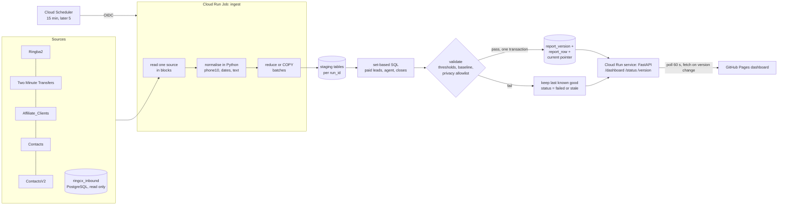

# Phase C: PostgreSQL feasibility, schema, ingestion and ordering design

Status: **design only. Nothing here has been run against any database, and no cloud resource, schema, secret or
permission has been created or changed.** Work is on `feature/scalable-platform-audit` (HEAD `64d1520`, base
`f60cc13`, nothing pushed). Everything below is labelled **Verified** (I ran or read it in this session),
**Reported** (stated in the repo from the owner's earlier checks; I cannot re-verify it) or **Unknown** (needs
access I do not have).

## 1. Summary and recommendation

1. **The memory bottleneck does not need a database.** Processing the five sources one at a time and freeing each
   before the next gives **553 MB at 1,000,000 rows per source, against 1,634 MB today (3.0x lower) and 2,468 MB for the
   release code**, at the same runtime, with output **identical** to the original on every comparable fingerprint (section 4).
   Block-wise reading of the largest source cuts its read-time peak from 392 MB to 90 MB (4.4x).
2. **A database is justified by other goals, not by memory**: durable snapshots to audit and diff, SQL-side
   reconciliation, an atomic versioned report for the API, and (for RingCX only) a faster, more reliable source than
   a slow spreadsheet. The report itself is 300 rows, so serving it needs almost nothing.
3. **Do not migrate anything yet.** Recommended order: (a) staged ingestion in the existing pipeline (no
   infrastructure), (b) collect the unknown RDS facts, (c) benchmark the schema on a scratch PostgreSQL, (d) the
   RingCX `source_seq` change by the table owner, (e) only then decide the reporting database and the Cloud Run
   design. Each step is gated on your approval (section 13).
4. **The 5-minute cadence is not achievable while the sources are spreadsheets** (reads historically take 3-17
   minutes and are dominated by Google's latency, not by our code). Start at 15 minutes with change detection and
   move to 5 only after the measured p95 end-to-end time is comfortably under 5 minutes.
5. **Set-based SQL reproduces the pandas rules exactly**, ties included, but only with explicit tie-break columns
   (section 7). Normalisation and name formatting must stay in Python.

## 2. Verified current state

| Item | Result |
|---|---|
| Branch / commits | `feature/scalable-platform-audit`: `64d1520` (lender filter), `780ceac` (vectorized parsing and timing), on `f60cc13`. Not pushed; no upstream |
| `main` / `origin/main` | `514774e` (stale local) / `f60cc13` (unchanged) |
| Tests | `pytest pipeline`: **504 passed**; `python -m pipeline.build --check-config`: `config OK` |
| Working tree | clean except `site/vendor/d3.v7.8.5.min.js` shown as modified (see 2.1) and the benchmark prototypes in `benchmarks/` |
| Local tooling | **No psql client, Docker or DuckDB is on PATH; a local PostgreSQL service exists but was not accessed.** Python's SQLite 3.49.1 is available. `psycopg 3.2.3` is installed |
| Machine | 15.6 GB RAM (about 5.5 GB free during the 1M runs), 12 logical cores |

### 2.1 The D3 status anomaly (non-destructive checks only)
The file is byte-identical to the committed blob (`cmp`; git object `8d56002...` in both). Git's index entry for it
still records the size from the earlier CRLF checkout (279,635 bytes against 279,633 on disk), and Git for Windows
2.55 keeps reporting `M` for it. I reproduced the identical behaviour in clean scratch repositories under six
`autocrlf` and attribute settings, so it is a Git-for-Windows quirk and not caused by this project. Only staging the
file or re-checking it out clears it. Neither was done; the file was not touched.

## 3. What the repository says about PostgreSQL

**Verified in code** (`pipeline/pg.py`, `config/report.yaml`, `docs/*.sql`, `.github/workflows/refresh.yml`):

- Read-only integration, off by default (`sources.ringcx.backend: sheets`). One REPEATABLE READ snapshot, read-only
  session, `statement_timeout` 60 s, `max_rows` 500,000, count-then-read consistency check, bound parameters only,
  errors report exception type and SQLSTATE only, no `ctid` or system columns allowed as the order.
- Table `public.ringcx_inbound`, columns used: `interaction_date`, `call_result`, `agent_full_name`, `ani`, `uii`,
  `queue` (`Two-Minute Transfers`). Order configured as `[interaction_date, source_seq]`; it **fails closed** until
  `source_seq` exists, is present on every row and is unique.
- The connection string comes from the GitHub secret `RINGCX_DATABASE_URL` and is used only by a manual preview
  comparison (`postgres-compare`); a publish run refuses the database source until `approved_for_dashboard: true`.
- The only table the project touches is `ringcx_inbound`. **No other table, index or query pattern exists in the
  repository**; the current report reads Google Sheets only.

**Reported by the owner (repo comments dated 24 Oct 2026; not re-verifiable here):**

- The table has had **222,165 rows inserted, 0 updated, 0 deleted** (a single straight load). The report's queue,
  `Two-Minute Transfers`, is only about **1,690 rows since 1 Apr 2026** (Apr 261, May 75, Jun 4, Jul 281, Aug 459, Sep
  409, Oct 197).
- Physical insertion order (`ctid`) reproduces the sheet's order for all 59 same-day multi-agent cases (agent shown
  for up to 11 of 300 leads); time order and `uii` order do not. `uii` repeats on 411 of 1,690 rows.
- The table is "maintained outside this project"; its loader follows the CSV line order of daily RingCX reports.
- Query planning facts that were not reported: indexes, constraints and table size (queries Q11 in
  `docs/ringcx_inbound_inspection.sql` exist but results are not in the repo).

**Unknown, and I have not assumed any of it** (the repository never names RDS, a host, a region or a version):

| Needed fact | Why it matters |
|---|---|
| Cloud and engine: confirm AWS RDS (or Aurora) PostgreSQL, major/minor version | extensions, `MERGE`, partition features, minor-version CVEs |
| Instance class, vCPU/RAM, storage type and size, IOPS, Multi-AZ, backup retention, region | capacity and cost; cross-cloud latency to Cloud Run |
| `max_connections`, current connection use, parameter group (`shared_buffers`, `work_mem`, `statement_timeout`) | pool sizing for API plus job |
| Database `datcollate` / `datctype`, server `TimeZone`, `interaction_date` type | string-ordering and date-boundary equivalence (section 7) |
| Network path: publicly accessible or private; security-group rules; how GitHub-hosted runners (dynamic IPs) reach it today | security exposure; whether Cloud Run can reach it and from which addresses |
| TLS enforcement and CA bundle; auth method (password, IAM auth); existing roles and grants | least-privilege design; secret handling |
| Who/what loads `ringcx_inbound`, how often, with what concurrency; whether other tables or consumers share the instance | durability of `source_seq`; blast radius of new load |
| Table sizes and index list for everything in the database | can the instance absorb extra storage and load |
| Spreadsheet facts: rows and used columns per source tab, how often historical rows are edited or deleted, whether the tabs are re-sorted | sizing, and which sources may ever read incrementally (section 8) |

A read-only script to collect most of these is in Appendix A. It returns settings and aggregates only, no rows.

## 4. The memory bottleneck: measured

Synthetic data (seed 1, five sources of equal size), same code, one process per run, fingerprints compared with the
**original release code (f60cc13)**. "Current" is Phase B plus the lender filter. Peak is process peak working set,
digests off. The staged flow loads one source, reduces it, frees it, then loads the next, reusing the real
functions in `pipeline/rules.py` unchanged (`benchmarks/bench_staged.py`).

| Rows per source | Release code | Current (peak / time) | Staged (peak / time) | Current / staged |
|---|---|---|---|---|
| 100,000 | 307 MB / 14.2 s | 223 MB / 1.49 s | **115 MB** / 1.52 s | 1.9x |
| 250,000 | 668 MB / 35.5 s | 459 MB / 3.77 s | **192 MB** / 3.61 s | 2.4x |
| 500,000 | 1,268 MB / 70.2 s | 851 MB / 7.37 s | **310 MB** / 7.22 s | 2.7x |
| 1,000,000 | 2,468 MB / 143 s | 1,634 MB / 14.5 s | **553 MB** / 14.3 s | 3.0x |

Release-code times are calculation only; current and staged times include loading from a local cache. Equivalence: at every size the staged flow's 7 comparable
fingerprints (selected leads, leads with agents, lender table restricted to the leads' phones, leads with closes,
**published rows**, totals, diagnostics) are IDENTICAL to the saved fingerprints; at 1M they are identical to the
original release code's. Peak grows by about 0.55 KB per row per source (so about 2.7 GB at 5M rows per source, an
extrapolation). The advantage widens with scale because current holds five sources at once and staged holds one.

**Reading a Sheets response** (Ringba columns, 1M rows x 6 columns, a 57 MB JSON body): parsing the whole response
as `sheets.py` does peaks at **392 MB**; reading it in ten 100,000-row blocks and discarding each peaks at
**90 MB** (`benchmarks/proto_json_read.py`).

Caveats: synthetic data is not your data; the load step is an unpickle, not a network read; block reads do not yet
reduce anything and need a consistency guard (section 8.3); the real tabs may have many more columns than the ones
read, which does not change the memory (only configured columns are requested) but does change the 20-million-cell
ceiling below.

## 5. External limits verified in this session

| Fact | Source |
|---|---|
| Sheets API: **300 reads/min per project, 60/min per user**; **180 s** request timeout; **2 MB** recommended payload; exceeding quotas is "planned to incur charges later in 2026" | Google Sheets API usage limits page |
| A spreadsheet may hold **20 million cells** (and 100 MB for converted files); raised from 10 million (GA September 2026) | Google Workspace Updates |
| Cloud Run: files written to the container filesystem **count against the memory limit** (in-memory filesystem, up to 32 GiB); **job tasks may run up to 168 hours** (default 10 min) | Cloud Run docs |
| Drive `modifiedTime` updates on any modification; a changes feed and push notifications exist; revision lists "might be incomplete" for frequently edited Sheets | Drive API docs |

Consequences: temporary files do not save memory on Cloud Run (use a bucket or a database for spill, or avoid
spilling); a slow spreadsheet cannot be sped up by reading it in many small requests, because each request pays the
spreadsheet's latency; and Drive revisions cannot serve as a complete change log, so change detection must come from
re-reading and comparing.

## 6. Proposed architecture

### 6.1 Three stages, each independently useful and reversible

**Stage 1 - staged ingestion in the existing pipeline (no infrastructure).** Replace "read all five, then
calculate" with "read, reduce, free" per source in dependency order:
Ringba (decides the paid leads) -> RingCX (keep only calls from those leads' phones) -> each lender (keep only records
with those phones, using the existing `prepare_lenders(phones=...)`). Large, fast sources may be read in row blocks
and reduced per block. Per-source row counts, status inventories and Closed-tab cross-checks are computed while each
source is in memory. Publication still happens once, at the end, after every validation. Controlled by a
configuration switch with the current flow as the default, so rollback is a one-line change.

**Stage 2 - durable staging and versioned publication in a database (only if justified, section 10).** The job
writes normalised rows to staging tables, selects the report with set-based SQL, and publishes a version atomically.
The API reads only the published version.

**Stage 3 - move volatile sources off spreadsheets**, source by source, only where measurement shows it pays
(RingCX first, because its tab is small and slow).

### 6.2 Data flow (Stage 2 shown; Stage 1 is the same left-hand side without the database)



Single-flight: an advisory lock (or a conditional write to the run table) ensures two jobs never run at once.
The API holds a read-only identity and can never see staging tables or any phone number.

### 6.3 Fail-closed rules (carried over unchanged)
A source that fails or returns a partial response fails the run; an empty result is never assumed from a failure.
Counts below `min_rows`, unknown lender statuses, a Closed-tab count mismatch, unreadable paid-call times, baseline
movement outside the configured thresholds, a field outside `publish.fields`, or any phone/email-like value in a
public file all stop publication. A failed run leaves the published pointer where it was, so the dashboard keeps the
last complete, validated report and shows `stale` or `failed` with the true last-success time.

## 7. Schema and query design (draft; **not executed anywhere**)

Separate schema `bff`, owned by a dedicated migration role. Nothing is placed in `public`.

```sql
CREATE TABLE bff.ingest_run (
  run_id bigint GENERATED ALWAYS AS IDENTITY PRIMARY KEY,
  started_at timestamptz NOT NULL DEFAULT now(), finished_at timestamptz,
  status text NOT NULL CHECK (status IN ('running','staged','validated','published','failed')),
  trigger text NOT NULL, code_version text NOT NULL, config_sha256 text NOT NULL,
  source_stats jsonb NOT NULL DEFAULT '{}', failure text);

-- staging: one list partition per run, dropped when old (cheap deletes, no bloat)
CREATE TABLE bff.stg_ringba (
  run_id bigint NOT NULL, sheet_row int NOT NULL,
  call_id text COLLATE "C" NOT NULL, call_time timestamp(3), phone_h bytea NOT NULL,
  payout numeric(12,2), connected boolean NOT NULL, converted boolean NOT NULL,
  PRIMARY KEY (run_id, sheet_row)) PARTITION BY LIST (run_id);
CREATE TABLE bff.stg_ringcx (
  run_id bigint NOT NULL, source_seq bigint NOT NULL, day date, result text NOT NULL,
  agent text NOT NULL, phone_h bytea NOT NULL, PRIMARY KEY (run_id, source_seq)) PARTITION BY LIST (run_id);
CREATE TABLE bff.stg_lender (
  run_id bigint NOT NULL, lender text NOT NULL, lender_ord smallint NOT NULL, sheet_row int NOT NULL,
  status text NOT NULL, close_ts timestamp(3), debt numeric(14,2), is_closed boolean NOT NULL,
  is_active boolean NOT NULL, phone_h bytea NOT NULL, PRIMARY KEY (run_id, lender, sheet_row)) PARTITION BY LIST (run_id);

-- output: only the approved public fields (config publish.fields), one set per version
CREATE TABLE bff.report_version (version_id bigint PRIMARY KEY, run_id bigint NOT NULL REFERENCES bff.ingest_run,
  created_at timestamptz NOT NULL DEFAULT now(), totals jsonb NOT NULL, validation jsonb NOT NULL);
CREATE TABLE bff.report_row (version_id bigint NOT NULL REFERENCES bff.report_version, lead_id text NOT NULL,
  /* ... exactly the 21 allowlisted fields ... */ PRIMARY KEY (version_id, lead_id));
CREATE TABLE bff.report_summary (version_id bigint NOT NULL, grain text NOT NULL CHECK (grain IN ('week','month')),
  period date NOT NULL, metrics jsonb NOT NULL, PRIMARY KEY (version_id, grain, period));
CREATE TABLE bff.current_report (singleton boolean PRIMARY KEY DEFAULT true CHECK (singleton),
  version_id bigint NOT NULL REFERENCES bff.report_version, published_at timestamptz NOT NULL DEFAULT now());
```

**Indexes, from the actual query patterns** (verify each with `EXPLAIN (ANALYZE, BUFFERS)` in the benchmark; add none
that the plans do not use):

| Query | Index |
|---|---|
| latest paid call per phone | `stg_ringba (run_id, phone_h, call_time DESC, call_id DESC, sheet_row DESC) WHERE payout > 0 AND call_time IS NOT NULL` |
| calls per phone (window phones only) | rely on the partition scan or `(run_id, phone_h)`; measure first |
| first accepted call on or after the paid date | `stg_ringcx (run_id, phone_h, day, source_seq) WHERE result = 'Inbound Accepted'` |
| earliest qualifying close | `stg_lender (run_id, phone_h, close_ts, lender_ord, sheet_row) WHERE is_closed` |
| API list, pagination, week filter | `report_row (version_id, lead_id)` keyset pagination; `(version_id, week_start)` |

**Privacy.** Staging stores `phone_h = HMAC-SHA256(secret, phone10)` instead of the phone, with the key in a secret
manager. Joins work on the hash; the database holds no phone numbers of its own (the existing `ringcx_inbound`
already holds raw `ani`, which this does not change). Debugging needs the key, which is the point. Owner decision.

**Queries.** Three set-based statements (portable `ROW_NUMBER()` form, `benchmarks/proto_sql_equivalence.py`):

1. Paid leads: `ROW_NUMBER() OVER (PARTITION BY phone ORDER BY call_time DESC, call_id DESC, sheet_row DESC)`, keep 1, newest N, join calls-per-phone.
2. Answering agent: `ROW_NUMBER() OVER (PARTITION BY lead ORDER BY day, source_seq)` over accepted calls with `day >= date(call_time)`.
3. Closes: `ROW_NUMBER() OVER (PARTITION BY lead ORDER BY close_ts, lender_ord, sheet_row)` over closed-status records with `date(close_ts) >= date(call_time)`.

**Equivalence evidence (SQLite, in memory; PostgreSQL itself not tested).** The SQL gives the same leads, call counts,
answering agents, closes, lenders, rows, statuses, dates, debts, active flags, `in_lender_crm` flags and excluded
counts as the pandas rules on: synthetic 20,000 and 100,000 rows per source (9 and 17 same-day multi-agent ties among
the 300 leads); 150 random lender-collision cases; 150 random paid-lead/tie cases (931 same-day multi-agent ties).
The harness inserts staging rows in **shuffled physical order**, and it is shown to fail when a tie-break is removed
or reversed. Without the shuffle, removing the tie-break still passed, because SQLite returned tied rows in insertion
order. That is the `ctid` trap in miniature and the reason for rule S1 below.

**Rules for the SQL (each must have a test):**
- **S1** Every `ORDER BY` that decides a tie uses an explicit column (`source_seq`, `sheet_row`); never physical order.
- **S2** Text columns used for ordering (`call_id`) use `COLLATE "C"`; pandas orders by code point, and a locale collation can differ.
- **S3** Phone normalisation, date parsing, alias mapping and the display-name formatting of agents (`str.title()`)
  stay in Python. PostgreSQL `regexp_replace('\D')` and `initcap` have different Unicode and punctuation behaviour.
- **S4** Dates compared by calendar day are stored as `date`; the reporting time zone is explicit, never the server's.
- **S5** `numeric` for money, `timestamp(3)` for call times (the Python side rounds serials to the millisecond).

## 8. Full refresh, incremental refresh and reconciliation

### 8.1 Comparison

| | Full refresh each run | Incremental (read only new/changed) | Full read + reconciliation |
|---|---|---|---|
| Exactness vs current output | By construction | Only if no historical row can change, delete or move | By construction, plus an independent check |
| Handles edits / deletes / reordering | Yes (recomputed) | **No**, unless detected by reading everything | Yes, and reports which |
| Read cost from Sheets | Every run | Smaller only if the API can say what changed; **it cannot** (Drive `modifiedTime` says "changed", not "where"; revisions can be incomplete) | Every run |
| Memory | Low with staged ingestion | Lowest | Low |
| Complexity / risk | Lowest | Highest: a missed edit is published as truth | Moderate |
| Verdict | **Default for every Sheets source** | Only for append-only sources with proven immutability and a real change key (none proven today) | **Add for any source with a second path** (RingCX Sheets vs PostgreSQL) |

Conclusion: incremental reads from Google Sheets cannot be proven safe, and the saving would be small anyway
because the Sheets read is dominated by per-request latency. The gain comes from reading less often (skip a run when
nothing changed) and from moving a source off Sheets, not from partial reads.

### 8.2 Per source

| Source | Mutable? | Used for | Recommended mode |
|---|---|---|---|
| Ringba `Ringba2` | Appended; whether payouts or rows are edited later is **Unknown** | latest paid call per phone across all history; calls per phone | Full each run. Incremental only after the owner confirms immutability and a call-id key |
| RingCX `Two Minute Transfers` | Appended by an importer; edits Unknown | accepted calls on/after the paid date for 300 phones (about 1,690 rows) | Full each run (tiny). Reconcile against PostgreSQL daily while Sheets is authoritative |
| Citizen `Affiliate_Clients` | **Mutable** (status and dates change; 1,728 closed records) | closes | Full each run. Never incremental |
| Cordoba `Contacts` | **Mutable** | closes | Full each run |
| DebtBlue `ContactsV2` | **Mutable** | closes | Full each run |

### 8.3 Detection and reconciliation mechanisms
- **Skip when unchanged:** a metadata probe (Drive `modifiedTime`) before a run, then a full run when any source
  changed. Needs a Drive read-only metadata scope: **a new permission, requires approval, and whether the narrow
  `drive.metadata.readonly` scope suffices is unverified**.
- **Consistent snapshot across block reads:** one request is atomic; many are not. Read `modifiedTime` before and
  after the blocks and discard the read if it moved; keep single-request reads for small or slow tabs.
- **Row-level fingerprints:** per-row content hash plus a running order hash per 10,000-row block, stored with each
  run. Compared with the previous run they report inserts, deletions, value changes and reordering as a diagnostic
  (not as a way to skip work), since Sheets rows have no stable ID.
- **Cross-source reconciliation:** Sheets vs PostgreSQL for RingCX (existing `compare_ringcx`, extended with a
  per-caller-day ordered-agent hash).
- **Always:** row counts against `min_rows`, status inventory, Closed-tab count, baseline thresholds; any mismatch fails.

## 9. RingCX durable ordering (`source_seq`)

Goal: reproduce "first accepted call on or after the paid date; same-day ties go to the original sheet row order"
from the database, with Google Sheets authoritative until equivalence is proven and **you** approve the switch.
Forbidden as the order: `ctid`, timestamps alone (they do not reproduce the ties), `uii` (not unique).

**Layer 0 - the owner's existing script** (`docs/ringcx_inbound_source_seq.sql`): once, in a maintenance window with the
loader paused, add `source_seq bigint`, number rows in current physical order, attach a sequence default, `NOT NULL`.
Its read-only pre-checks (0 updates, 0 deletes, 0 dead tuples, `vacuum_count` 0) are what justify trusting physical
order for this one-time capture. My review adds: make the `UNIQUE` constraint **mandatory** (it is optional there);
take an advisory lock around loads so two writers cannot interleave; load with `COPY` or `INSERT ... SELECT ... ORDER BY line_no` (an unordered `INSERT ... SELECT`
does not guarantee order); sequence gaps are harmless, reuse is not; never renumber.

**Layer 1 - provenance, additive and re-derivable.** Add `load_batch_id` (FK to `ringcx_load_batch(batch_id, source_file,
file_sha256, report_ordinal, row_count, loaded_at)`) and `src_line_no`, unique together. Order is then
`(report_ordinal, src_line_no)`, independent of physical storage, so a dump/restore, `VACUUM FULL`, `CLUSTER` or a
re-load can rebuild `source_seq` and a check can prove it. Legacy rows (no provenance) keep their frozen Layer 0 numbers.

**Layer 2 - continuous verification while Sheets stays authoritative.** Every refresh already compares the database to
the sheet over the days both cover. Add: an ordered-agent hash per caller-day for all multi-agent days, a counter of
consecutive clean comparisons, and a count of tie cases covered. Proposed gate to ask for approval: at least 14
consecutive clean daily comparisons and at least 20 tie cases verified beyond the 59 historical ones, zero
missing/duplicate `source_seq`.

**Test matrix (all must pass before approval; each is a unit test on synthetic data plus a staging-database test):**

| Case | Expected |
|---|---|
| append a new report | new rows get larger `source_seq`; earlier tie decisions unchanged |
| UPDATE a row (value or status) | `source_seq` unchanged; attribution follows the new value |
| DELETE a row | gap in `source_seq`; ties among the remaining rows keep relative order |
| sheet rows re-sorted by a human | ordered-agent hash mismatch on tie days; **run fails closed / reports; Sheets remains authoritative** |
| duplicate or NULL `source_seq` | run fails closed (already implemented) |
| two loaders at once | second blocked by lock; test that order is still the report order |
| dump and restore, `VACUUM FULL`, `CLUSTER` | order unchanged (the reason `ctid` is rejected) |
| sheet and database disagree on a tie | listed in the report with counts only; switch not allowed |

For snapshots of the sheet itself (Stage 2 staging), `sheet_row` within one immutable run is authoritative by
definition; it is deliberately not carried across runs, because humans can insert, delete or sort rows.

## 10. Is the existing PostgreSQL/RDS suitable? Options

Workload (Stage 2): staging up to about 1M rows x 5 sources per run, 3 runs retained, 8,640 runs per month at a
5-minute cadence (2,880 at 15 minutes); output 300 rows per version; API polling every 60 s per open dashboard.

| Option | Fit | Main concerns |
|---|---|---|
| A. **No database for output**: versioned JSON objects plus a pointer in object storage | Serves a 300-row report perfectly; conditional writes give atomic publication; costs cents | No staging history, no SQL reconciliation |
| B. **Existing PostgreSQL/RDS** | Probably adequate for this size, **if** capacity, versions and access check out (section 3) | Cross-cloud latency and egress if RDS is in AWS and the job on Google Cloud; public exposure and dynamic Cloud Run egress addresses; shared instance with the external loader; every `Unknown` above |
| C. Cloud SQL for PostgreSQL | Same cloud and region as Cloud Run (private connectivity, no cross-cloud egress) | A new paid resource and a second database to operate; only justified if B fails on networking or capacity |
| D. BigQuery | Excellent for scans; on-demand $6.25/TiB after 1 TiB free | Wrong shape for 300-row low-latency reads and for transactional pointer swaps; per-query cost model |

**Recommendation:** decide after the fact-finding in section 3 and the local benchmark in section 11. Prefer A for the
published report and B for staging **only if** the network path is private or TLS-pinned with a static address, the
instance has headroom, and the owner approves a separate schema and roles. Do not choose C or D without evidence that B
fails. If RDS turns out to be reachable only through a public endpoint open to the internet, treat that as a risk to
fix before any new load is added (the existing GitHub-runner path suggests it may be).

Security requirements for any option: dedicated roles (`bff_ingest` writes staging and runs the publish function;
`bff_api` reads only report views; the existing read-only role reads only `ringcx_inbound`), no superuser, no
cross-schema grants, TLS with certificate verification, credentials only in a secret manager (never in the frontend
or the repo), bounded pools (job 2-4, API 2-5), `statement_timeout` and `idle_in_transaction_session_timeout` set per
role, `ingest` authenticated service-to-service (OIDC from the scheduler).

## 11. Benchmark plan

**Done (this session, local, synthetic):** current vs staged ingestion at 100k to 1M rows (section 4); JSON response
parse whole vs blocks; SQL-logic equivalence in SQLite. Reproduce with `benchmarks/bench_staged.py`,
`proto_json_read.py`, `proto_sql_equivalence.py`.

**Next, needs a PostgreSQL to measure (approval, section 13):** generate 1M, 5M and 10M rows per source; for each
chunk size (10k, 50k, 100k) measure `COPY` throughput, staging-to-report SQL time (p50/p95, cold and warm),
`EXPLAIN (ANALYZE, BUFFERS)` per query, index sizes and build time, WAL volume, worker peak memory, and connection use.
Correctness gate: report rows byte-identical to the pandas fingerprints. Failure injection: kill the job mid-load, bad
row, duplicate `source_seq`, two concurrent jobs, statement timeout, connection loss - each must leave the published
pointer unchanged. Memory limits are enforced by keeping each run under 60% of free RAM and stopping at the first
swap.

**Pass criteria (proposed):** end-to-end ingest plus report under 3 minutes at 1M rows per source on the chosen
instance; worker peak under 1 GiB at 1M; zero fingerprint differences; zero unplanned changes to the published pointer.

## 12. Cost estimates (order of magnitude; verify before relying)

Prices are from Google's published tables as quoted by search results (undated) and third-party aggregators; the
official pricing pages could not be fetched here. Treat as estimates, not quotes. No resource has been created.

| Item | Basis | Estimate |
|---|---|---|
| Cloud Run job, 1 vCPU / 1 GiB, 10 min per run (measured Sheets reads dominate) | $0.000018 per vCPU-s, $0.000002 per GiB-s; free 240,000 vCPU-s and 450,000 GiB-s per month | hourly cadence about **$3.5**/month; 15-minute cadence about **$29**/month; skip-when-unchanged with a few real runs a day: **free tier** |
| 5-minute cadence | reads take 3-17 min, runs would overlap | **not viable** until reads are faster or parallel |
| Cloud Scheduler | 3 free jobs per billing account (unverified) | $0 |
| Cloud Run service (FastAPI), scale to zero | 2M free requests; one open dashboard polling every 60 s is 43k requests/month | $0 to a few dollars |
| Existing RDS | already paid | **$0 incremental** if capacity suffices; staging well under 5 GB |
| New instance, if needed | RDS db.t4g.micro about $12, db.t4g.small about $23 per month (third party); Cloud SQL shared core about $8 to $26 per month compute only, HA roughly doubles; storage, backups and egress extra | $12 to $60/month |
| Cross-cloud transfer, if job on Google Cloud and RDS on AWS | about 300 MB of staging per full 1M-row run; at 2,880 runs/month that is about 860 GB leaving Google | **roughly $100/month at about $0.12/GB (unverified)**; this is the strongest reason to reduce rows before they cross clouds or to keep staging in the same cloud |
| BigQuery | $6.25/TiB after 1 TiB free | $0 at this size, but poor fit (section 10) |
| Sheets API quota charges | "planned" later in 2026 | negligible at about 20 requests per run |

## 13. Risks, information needed, approvals

| Risk | Mitigation |
|---|---|
| Treating a hidden Sheets edit as unchanged | Full read every run; incremental only with proven immutability |
| `source_seq` loader not single-writer or not ordered | Layer 0 pre-checks, UNIQUE, advisory lock, ordered load, Layer 1 provenance, Layer 2 gate |
| PostgreSQL vs Python semantics (collation, `initcap`, `\D`, time zones) | Rules S1-S5; every query has an equivalence test on PostgreSQL before use |
| Cross-cloud latency, egress cost, public exposure | Decide location first; reduce rows before transfer; private path or pinned TLS; otherwise Cloud SQL |
| Block reads against slow tabs multiply per-request latency | Keep `read_whole_tab` for slow tabs; measure on the real sheets first |
| Cloud Run memory includes files written | Do not spill to local disk; use blocks, a bucket, or a database |
| Sheets quota changes become billable | Request counts are recorded per run; alert at 50% of quota |
| Prototype benchmarks use synthetic data | Re-run on a one-off export of the real tabs kept outside the repo, with your permission |

**I need from you (no access required from me):** the Appendix A output; confirmation of cloud/region/instance/network
for the database; per-tab row and column counts; whether historical Ringba/lender rows are edited or tabs re-sorted;
who owns and operates the `ringcx_inbound` loader.

**Approvals requested (in order; I will not start any without a yes):**
1. Commit the three prototypes and this document to the feature branch (local only).
2. Stage 1 code: staged ingestion behind a configuration switch (default off), with equivalence tests. Changes `pipeline/` code, no infrastructure.
3. Download PostgreSQL 16 Windows x64 binaries (official zip, size to be confirmed before download) and run it locally on a scratch directory to execute section 11. Alternative: you provide a scratch database.
4. Any use of a real database: read-only fact-finding by the owner (Appendix A); nothing else without a separate approval.

## 14. Phased plan with rollback

| Step | Content | Gate to proceed | Rollback |
|---|---|---|---|
| C0 | This design reviewed | your approval | none needed |
| C1 | Appendix A facts collected by the owner | facts reviewed | none |
| C2 | Stage 1 staged ingestion, flag default `full`; preview-run both modes in CI, compare fingerprints on a real preview run | zero differences on real data; memory and time measured | set the flag to `full` |
| C3 | Local PostgreSQL benchmark (section 11) | pass criteria met; decision on database option | discard the scratch database |
| D | RingCX: owner runs Layer 0 in a maintenance window; add Layer 1; Layer 2 verification in preview | section 9 gate and **your explicit approval** | `backend: sheets` (unchanged default) |
| E | FastAPI, job, versioned publication, frontend polling, behind a new URL, GitHub Pages untouched | staging environment passes failure-injection tests | do not route the frontend; delete the new service |
| F | Deployment preparation, cost sign-off, security review, rollback runbook | your approval to create paid resources | disable the scheduler; old workflow remains |

At no step does production `main`, GitHub Pages, the production schema, any scheduled refresh or any paid resource change
without a separate, explicit approval from you.

## Appendix A - read-only fact-finding for the database owner

Run on a read-only role, in a read-only transaction. Settings and aggregates only; no rows, no phone numbers.

```sql
SET default_transaction_read_only = on;
BEGIN READ ONLY;
SET LOCAL statement_timeout = '30s';
SELECT version();
SELECT current_database(), pg_encoding_to_char(encoding) AS encoding, datcollate, datctype
  FROM pg_database WHERE datname = current_database();
SHOW server_version;  SHOW TimeZone;  SHOW max_connections;  SHOW shared_buffers;  SHOW work_mem;
SHOW statement_timeout;  SHOW ssl;  SHOW wal_level;  SHOW max_wal_size;
SELECT count(*) AS connections_now, count(*) FILTER (WHERE state = 'active') AS active FROM pg_stat_activity;
SELECT extname, extversion FROM pg_extension ORDER BY 1;
SELECT n.nspname, c.relname, c.relkind, pg_size_pretty(pg_total_relation_size(c.oid)) AS total_size, c.reltuples::bigint AS est_rows
  FROM pg_class c JOIN pg_namespace n ON n.oid = c.relnamespace
  WHERE n.nspname NOT IN ('pg_catalog','information_schema','pg_toast') AND c.relkind IN ('r','p','m')
  ORDER BY pg_total_relation_size(c.oid) DESC LIMIT 30;
SELECT schemaname, relname, n_tup_ins, n_tup_upd, n_tup_del, n_live_tup, n_dead_tup, vacuum_count, autovacuum_count, last_autovacuum
  FROM pg_stat_user_tables ORDER BY n_live_tup DESC LIMIT 30;
SELECT rolname, rolsuper, rolcreatedb, rolcanlogin, rolconnlimit FROM pg_roles WHERE rolname !~ '^pg_' ORDER BY 1;
SELECT count(*) AS ssl_connections FROM pg_stat_ssl WHERE ssl;
ROLLBACK;
```

Also from the AWS console (not SQL): engine and minor version, instance class, storage type/size/IOPS, Multi-AZ,
backup retention, region/AZ, "Publicly accessible", security-group inbound rules, parameter group name, whether IAM
database authentication is enabled, and the monthly cost of the instance.
